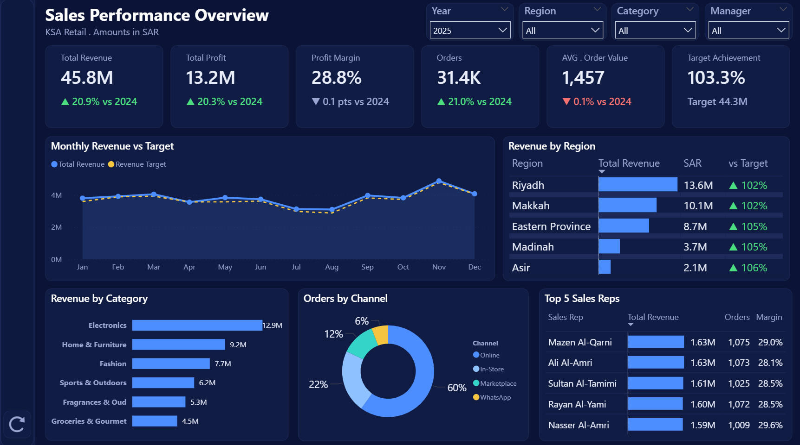
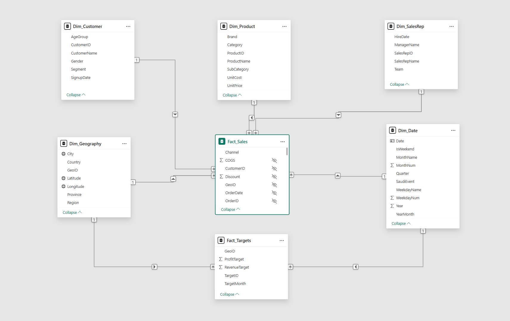
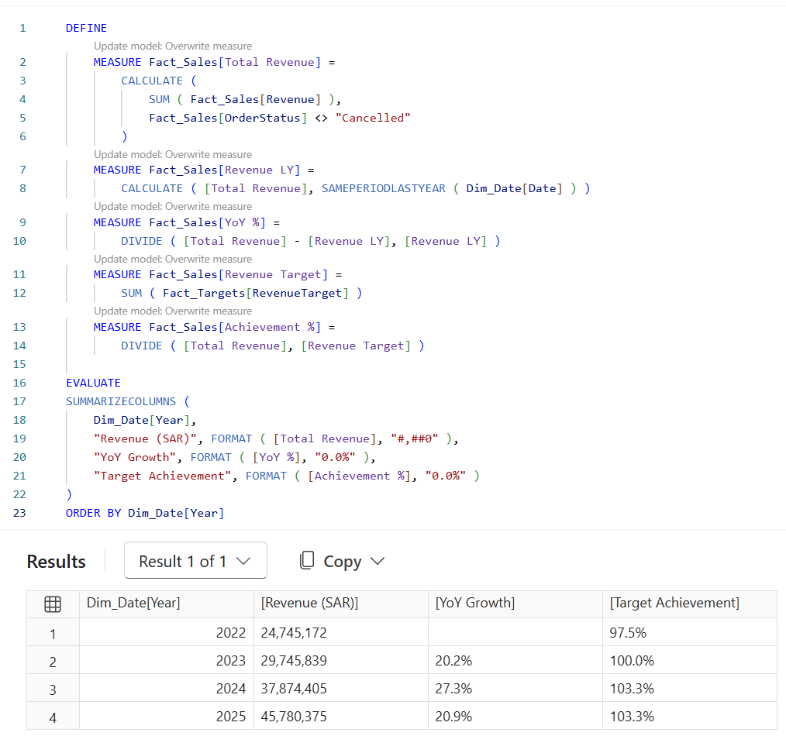

# KSA Retail Sales Performance Dashboard | Power BI

An end-to-end Business Intelligence project analyzing **100,000 retail orders across Saudi Arabia (2022–2025)**, from data modeling to an interactive executive KPI dashboard.

🔗 **[View the live interactive dashboard](https://app.powerbi.com/view?r=eyJrIjoiNDE5ZWY2YzctMTNmYy00NWEwLWEzOTctYTRmNzVkZjBmYWVhIiwidCI6IjJiYjZlNWJjLWMxMDktNDdmYi05NDMzLWMxYzZmNGZhMzNmZiIsImMiOjl9)**

> ⚠️ The dataset is **synthetic** and was created for learning and portfolio purposes. It does not represent any real company.



---

## 🔍 Key Insights (2025)

- **Revenue reached SAR 45.8M**, up **20.9% YoY** and nearly doubling since 2022 (SAR 24.7M)
- **Target achievement improved** from 97.5% in 2022 to **103.3%** in 2025
- **Growth was volume-driven:** orders grew 21% while average order value stayed flat
- **White Friday makes November the peak month**; July and August are the slowest
- **Riyadh and Makkah regions** generate over half of total revenue
- **Online drives 60%** of all orders

| Year | Revenue (SAR) | YoY Growth | Target Achievement |
|------|--------------:|-----------:|-------------------:|
| 2022 | 24,745,172 | – | 97.5% |
| 2023 | 29,745,839 | 20.2% | 100.0% |
| 2024 | 37,874,405 | 27.3% | 103.3% |
| 2025 | 45,780,375 | 20.9% | 103.3% |

---

## 📊 Dashboard Features

- **6 executive KPIs:** Total Revenue, Total Profit, Profit Margin, Orders, Average Order Value, Target Achievement
- **Year-over-year comparison** on every KPI with color-coded ▲/▼ indicators
- **Monthly revenue vs target** trend
- **Top 5 regions** with target achievement
- **Revenue by category** and **orders by channel**
- **Top 5 sales reps** with revenue, orders and margin
- **Slicers:** Year, Region, Category, Manager
- **Reset button** (bookmark) to return to the default view
- **Seasonal tooltip:** hovering over a month shows the Saudi season in that period (e.g. White Friday, Ramadan, National Day)

---

## 🗂️ Data Model

Star schema with **2 fact tables** and **5 dimension tables**, using one-to-many relationships with single-direction filtering.



| Table | Type | Description |
|-------|------|-------------|
| `Fact_Sales` | Fact | 100,000 orders: quantity, price, discount, revenue, cost, profit, channel, payment method, status |
| `Fact_Targets` | Fact | Monthly revenue and profit targets per city |
| `Dim_Date` | Dimension | Calendar 2022–2025 with Saudi seasons (Ramadan, Eid Al-Fitr, Eid Al-Adha, National Day, Founding Day, White Friday) and Fri–Sat weekend |
| `Dim_Customer` | Dimension | 5,000 customers: segment, gender, age group |
| `Dim_Product` | Dimension | 88 products across 6 categories |
| `Dim_Geography` | Dimension | 22 Saudi cities across 13 regions, with latitude/longitude |
| `Dim_SalesRep` | Dimension | 30 sales reps with managers and teams |

---

## 🧮 DAX Highlights



```dax
Total Revenue =
CALCULATE (
    SUM ( Fact_Sales[Revenue] ),
    Fact_Sales[OrderStatus] <> "Cancelled"
)

Revenue LY =
CALCULATE ( [Total Revenue], SAMEPERIODLASTYEAR ( Dim_Date[Date] ) )

YoY % =
DIVIDE ( [Total Revenue] - [Revenue LY], [Revenue LY] )

Achievement % =
DIVIDE ( [Total Revenue], SUM ( Fact_Targets[RevenueTarget] ) )

Revenue YoY Label =
IF (
    NOT HASONEVALUE ( Dim_Date[Year] ) || ISBLANK ( [Revenue LY] ),
    BLANK (),
    IF ( [YoY %] >= 0, "▲ ", "▼ " )
        & FORMAT ( ABS ( [YoY %] ), "0.0%" )
        & " vs " & ( MAX ( Dim_Date[Year] ) - 1 )
)
```

Measures are organized into display folders: **Core KPIs**, **Time Intelligence**, **Display Labels** and **Formatting**.

---

## 🛠️ Tools

- **Power BI Desktop**: data modeling, DAX, report design
- **Power Query**: data type cleanup
- **DAX query view / TMDL view**: measure development and validation
- **Power BI Service**: publishing
- **Excel**: source data

---

## 📁 Repository Contents

- `KSA_Sales_Dashboard.pbix`: Full interactive Power BI report file.
- `KSA_Retail_Sales_BI.xlsx`: Source dataset (synthetic).
- `KSA_Navy_Theme.json`: Custom report theme.
- `images/`: Dashboard, data model and DAX screenshots.

  ---
  
## ▶️ How to Use

1. Download `KSA_Sales_Dashboard.pbix` and open it in [Power BI Desktop](https://www.microsoft.com/power-bi/desktop) (free).
2. If prompted, point the data source to `KSA_Retail_Sales_BI.xlsx` (Transform data → Data source settings → Change source).

---

**Author:** [Mazen Alqarni](https://www.linkedin.com/in/mazen-alqarni-)
